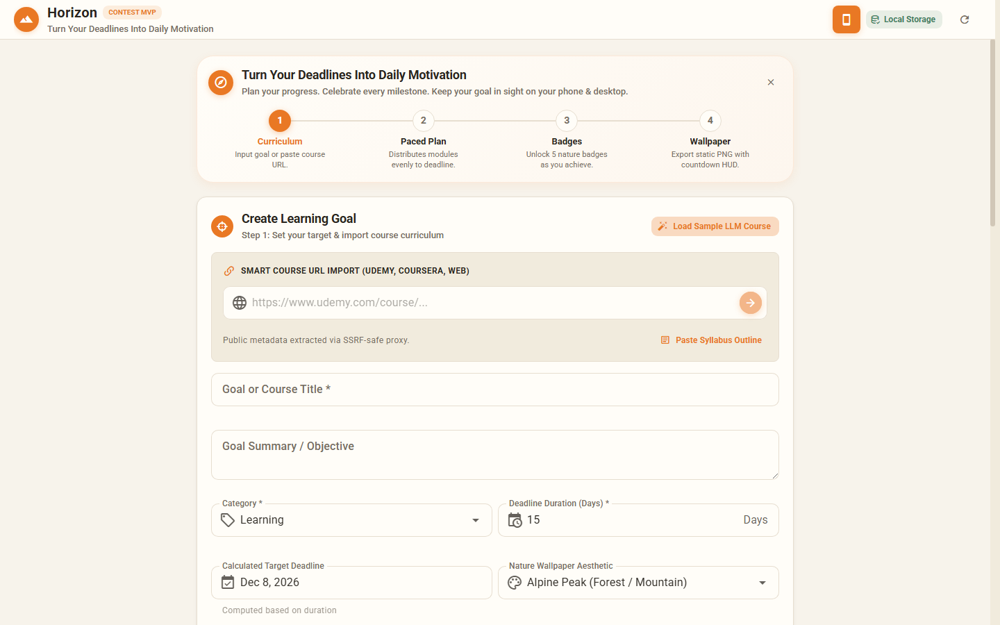
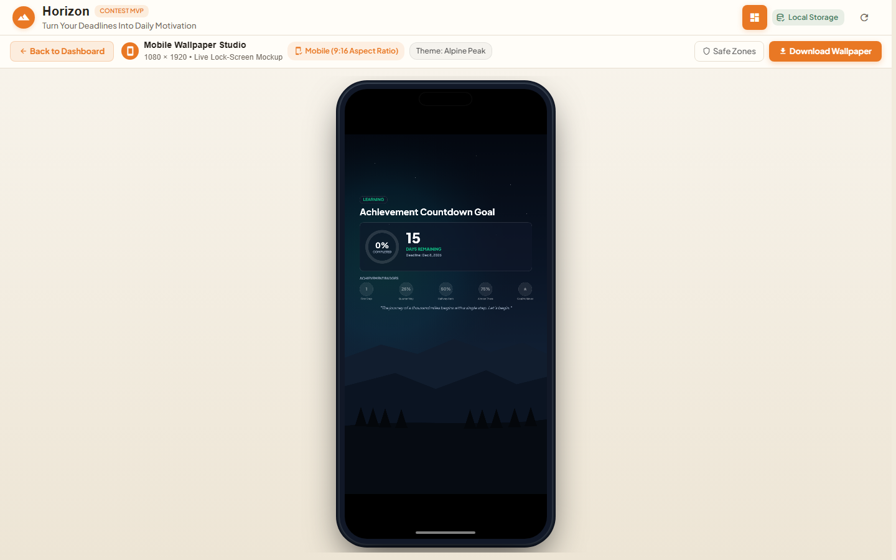
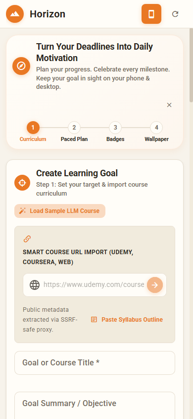
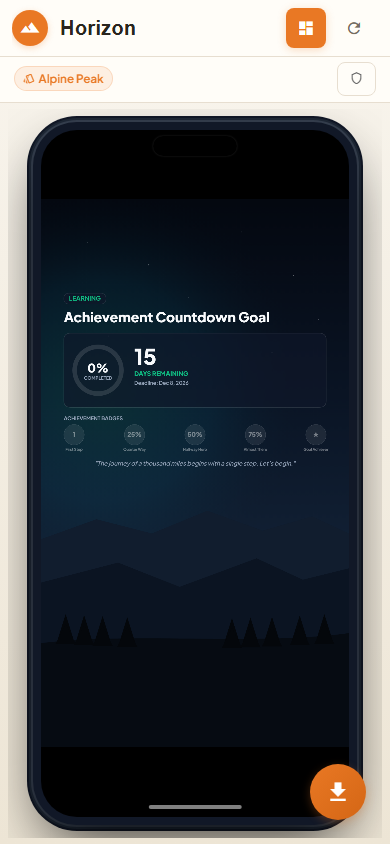

# Horizon — Achievement-Based Countdown Wallpaper Creator

[](https://github.com/khanusama20/Horizon)
[](https://vuejs.org/)
[](https://vitejs.dev/)
[](https://vuetifyjs.com/)
[](https://vitest.dev/)
[](https://github.com/khanusama20/Horizon)

> **Turn your deadlines into daily motivation.**  
> Horizon generates device-optimized lock-screen wallpapers featuring real-time countdown metrics, progressive milestone roadmaps, and nature-inspired achievement badges—keeping your goals in sight every time you pick up your phone or laptop.

---

## 📸 Application Showcase

### Main Dashboard (Goal Planning & Curriculum Setup)


### Dedicated Mobile Wallpaper Studio (1080 × 1920 Lock-Screen Preview)


### Mobile Responsive Experience
| Mobile Dashboard | Dedicated Mobile Preview |
| :---: | :---: |
|  |  |

---

## 🌟 Core Features

- **🎯 Smart Goal & Deadline Planning**:
  - Input custom learning goals, exams, or projects with dynamic target date calculations.
  - Guided 4-step visual stepper: *Curriculum & Target → Paced Plan → Badges → Wallpaper Studio*.
  - 1-click sample dataset for quick testing and evaluation.

- **🌐 Smart Curriculum Ingestion**:
  - **Public Course URL Import**: Scrapes syllabus titles and modules from public course pages (Udemy, Coursera, web outlines) through an SSRF-safe Express proxy.
  - **Raw Syllabus Parser**: Extracts modules, sections, and assignments directly from pasted outlines, bullet lists, or syllabus text.

- **🗺️ Paced Milestone Engine**:
  - Auto-distributes milestones evenly across available calendar days.
  - Intelligent weekend-skip configuration for sustainable work habits.
  - Assessment and quiz auto-detection with prominent milestone badges.
  - Interactive checkboxes recalculating progress percentages instantly.

- **🏆 Nature Achievement Badges**:
  - 5-stage progressive unlocks: *First Step (0%)*, *Quarter Way (25%)*, *Halfway Hero (50%)*, *Almost There (75%)*, and *Goal Achiever (100%)*.
  - Procedural badge icons with glowing milestone rings and motivational quotes.

- **🎨 Pure HTML5 Canvas Wallpaper Engine**:
  - Renders standalone static PNG wallpapers on the client without external image dependencies.
  - **Presets**: Mobile Smartphone (1080 × 1920, 9:16) and Desktop Monitor (1920 × 1080, 16:9).
  - Procedural multi-layer mountain peaks, mist layers, starry skies, and vector badge HUDs.
  - Toggleable **Lock-Screen Safe Zones** overlay preventing clock and notification occlusion.

- **📱 Dedicated Mobile Preview Studio**:
  - Full-screen isolated smartphone mockup featuring realistic dynamic island and home indicator bar.
  - Floating Action Button (FAB) for instant 1080 × 1920 static PNG export.
  - Smooth component switching with zero page reload and complete state and scroll preservation.

- **🔒 100% Client-Side Privacy**:
  - Zero cloud databases. All user goals, syllabus data, and completion statuses persist in browser `LocalStorage`.

---

## 🏗️ Architecture & Technology Stack

```
horizon/
├── src/
│   ├── components/
│   │   ├── layout/            # AppHeader, VisualStepper
│   │   ├── goals/             # GoalForm, QuickSyllabusModal
│   │   ├── milestones/        # MilestoneEngine, MilestoneItem
│   │   ├── badges/            # BadgeEngine, BadgeGrid
│   │   ├── wallpaper/         # MobileWallpaperPreviewPage, DeviceMockupPreview, DashboardPreviewCard
│   │   └── demo/              # DemoPresentationMode (Contest Mode)
│   ├── services/
│   │   ├── CanvasWallpaperEngine.js  # Pure HTML5 Canvas procedural rendering
│   │   ├── wallpaperExportService.js # High-res PNG packaging & download trigger
│   │   ├── milestoneEngine.js        # Timeline distribution & weekend filtering
│   │   ├── badgeEngine.js            # Threshold calculation & badge metadata
│   │   ├── syllabusParser.js         # Text & markdown outline tokenizer
│   │   ├── themeRegistry.js          # Nature theme definitions & color palettes
│   │   └── storage.js                # LocalStorage abstraction with quota guards
│   ├── plugins/                      # Vuetify 3 theme tokens (Warm Cream & Orange)
│   └── App.vue                       # View switching (Dashboard ⇄ Preview Studio)
├── server/
│   ├── index.js                      # SSRF-safe Express scraping proxy
│   └── scraper.js                    # Cheerio web scraper with platform adapters
└── tests/
    └── unit/                         # 14 Vitest suites (142 unit tests)
```

---

## 🚀 Getting Started

### Prerequisites
- **Node.js**: `v18.0.0` or higher (tested on Node v20/v24)
- **npm**: `v9.0.0` or higher

### Installation

1. Clone the repository:
   ```bash
   git clone git@github.com:khanusama20/Horizon.git
   cd Horizon
   ```

2. Install dependencies:
   ```bash
   npm install
   ```

3. Launch the development servers:
   ```bash
   npm run dev
   ```
   - **Frontend App**: `http://localhost:5173/` (or LAN IP)
   - **Course Ingestion API**: `http://localhost:3001/` (or LAN IP)

### 🌐 Centralized Server IP Configuration

To connect external devices (e.g. testing mobile wallpapers on your phone via Wi-Fi) or point to a remote server, edit [src/config/ipConfig.js](file:///c:/Users/MS%20Infra%20Works/OneDrive/Documents/Projects/horizon/src/config/ipConfig.js):

```javascript
export const IP_CONFIG = {
  serverIp: '192.168.31.34', // <-- Your server IP address
  serverPort: 3001,          // <-- Server port
  protocol: 'http',
  mode: 'direct'             // 'direct' | 'auto' | 'proxy'
};
```
Both the Vue frontend API client and the Vite dev proxy automatically route all requests to this configured IP!

---

## 🧪 Testing & Verification

Horizon maintains an automated test suite with **100% pass rate** across all core engines:

```bash
# Run complete unit test suite
npm run test

# Run Vitest in watch mode
npm run test:watch

# Build production bundle
npm run build
```

### Test Suite Coverage
```
 ✓ tests/unit/canvasEngine.spec.js (13 tests)
 ✓ tests/unit/wallpaperExportService.spec.js (19 tests)
 ✓ tests/unit/visualStepper.spec.js (7 tests)
 ✓ tests/unit/floatingDeviceSwitcher.spec.js (6 tests)
 ✓ tests/unit/demoPresentationMode.spec.js (12 tests)
 ✓ tests/unit/block7Verification.spec.js (15 tests)
 ✓ tests/unit/mobileWallpaperPreviewPage.spec.js (13 tests)
 ✓ tests/unit/scraper.spec.js (10 tests)
 ✓ tests/unit/badgeEngine.spec.js (9 tests)
 ✓ tests/unit/storage.spec.js (9 tests)
 ✓ tests/unit/milestoneEngine.spec.js (10 tests)
 ✓ tests/unit/ipConfig.spec.js (11 tests)
 ✓ tests/unit/goalValidation.spec.js (6 tests)
 ✓ tests/unit/syllabusParser.spec.js (6 tests)
 ✓ tests/unit/assessmentDetector.spec.js (7 tests)

 Test Files  15 passed (15)
      Tests  153 passed (153)
```

---

## 🎨 Design System

Horizon utilizes a **Warm Light Cream & Brand Orange** Material Design palette:

| Token | Hex Value | Usage |
| :--- | :--- | :--- |
| **Primary Orange** | `#E97824` | Brand identity, primary CTAs, active stepper indicator |
| **Primary Dark** | `#D96718` | Button hover and active states |
| **Warm Sand Background** | `#F8F4EC` | Global page background |
| **Surface Card** | `#FFFDF8` | Card elevation, elevated sheets, input fields |
| **Warm Espresso Text** | `#29251F` | High-contrast readable typography |
| **Warm Clay Subtitle** | `#756D62` | Secondary captions, helper descriptions |

---

## 📄 License & Attribution

Built for the **Handshake AI Skills Studio × Google Contest**.  
Released under the [MIT License](LICENSE).
