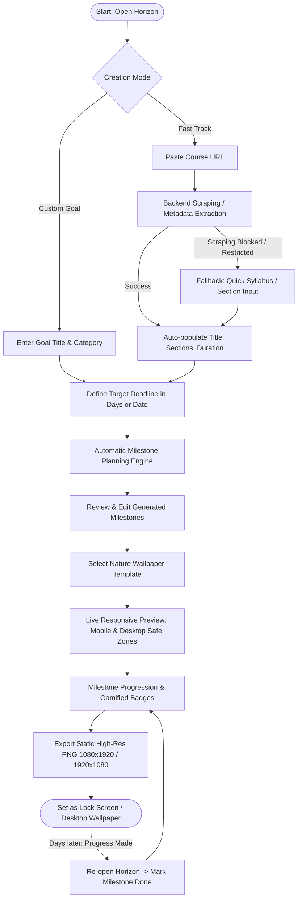

# Horizon — Master Project Plan

**Document Version:** 1.0.0  
**Status:** Under Architectural Review  
**Author:** Senior Software Architect & Technical Project Planner  
**Target Completion Timeline:** Contest-Ready / Production-Grade  

---

## 1. Executive Summary & Product Vision

### 1.1 Product Concept
**Horizon** is an achievement-based countdown wallpaper creator engineered to turn abstract deadlines and course curriculums into visceral, beautiful visual reminders. The core philosophy of Horizon is:

$$\text{Minimum User Input} \longrightarrow \text{Maximum Automatic Planning}$$

Rather than forcing users to manage sprawling project boards, complex calendar integrations, or rigid study planners, Horizon translates a simple goal (or a pasted course URL) into an automatically paced milestone plan, tracks progress gamified through nature-themed badges, and outputs a high-resolution, static PNG wallpaper custom-fitted for mobile lock screens and desktop displays.

### 1.2 The "Static Artifact" Principle
Horizon is intentionally designed as a **generator of static visual artifacts (PNG images)**. It does not attempt to be an active background daemon, wallpaper rotator, or OS service. 
- The generated wallpaper is completely static once exported.
- To reflect newly earned badges, updated countdown days, or completed milestones, users return to Horizon, mark their progress in seconds, and re-export a refreshed wallpaper.
- This architectural constraint guarantees **zero battery drain**, **zero OS permission friction**, **zero cross-platform native wrapper bloat**, and **maximum privacy** (100% client-driven data ownership).

---

## 2. Target Audience & Problem Statement

### 2.1 Target Audience
- **Students & Self-Learners:** Preparing for exams, academic semesters, or standardized tests.
- **Developers & Tech Learners:** Mastering technical skills, bootcamps, or video courses (e.g., Udemy, Coursera, YouTube playlists).
- **Certification Candidates:** Tracking structured preparation for AWS, GCP, CKA, CISSP, CompTIA, or PMP.
- **Goal-Driven Professionals:** Working toward tangible milestones like launching an MVP, writing an ebook, or fitness targets.

### 2.2 Core Problem
Digital project management tools (Notion, Jira, Trello, Todoist) suffer from high maintenance friction. Users spend more time organizing cards than studying. Conversely, lock-screen wallpapers are checked over 80–150 times a day by the average smartphone user. Horizon converts this habitual glance into a passive motivational anchor without requiring daily manual logging overhead.

---

## 3. Product Decisions vs. Technical Recommendations

To maintain architectural transparency, the table below clearly delineates between **Confirmed Product Requirements** (mandated constraints) and **Senior Architect Technical Recommendations** (engineered to deliver those requirements reliably).

| Category | Confirmed Product Decision | Architectural Recommendation / Justification |
| :--- | :--- | :--- |
| **Frontend Framework** | Vue.js 3.5.x | Composition API (`<script setup>`) with clean reactive composables. |
| **UI Component Library**| Vuetify 3.7+ (compatible with Vue 3.5+) | Note: Vuetify 3 is the stable production branch for Vue 3. Vuetify's responsive grid, cards, sliders, and icons accelerate UI development. |
| **Build Tool** | Vite 5.x / 6.x | Instant HMR, native ES modules, lightweight configuration, sub-second builds. |
| **Language** | JavaScript (ESNext) | Strictly typed JavaScript using JSDoc type annotations. Avoid TypeScript compilation overhead while preserving IDE autocomplete. |
| **Node.js Backend** | Evaluated for URL scraping | **Lightweight Node.js proxy required**. Direct browser `fetch()` to external sites (like Udemy) is permanently blocked by browser CORS policies and Cloudflare anti-bot. |
| **Persistence** | LocalStorage | LocalStorage for state persistence, paired with an optional JSON export/import for backup. Zero mandatory database/login for v1. |
| **Wallpaper Engine** | Static PNG export (1080×1920 mobile, 1920×1080 desktop) | **Off-screen HTML5 2D Canvas API**. HTML-to-image screen-scrapers (like `html2canvas`) suffer from font blurriness, cross-origin image tainting, and subpixel rendering artifacts. Canvas delivers deterministic, pixel-perfect exports. |
| **Course Import** | Paste course URL (e.g., Udemy) | Multi-tier extraction: (1) Headless metadata proxy via Node.js; (2) Regex/OpenGraph parser; (3) Fallback manual outline paste (JSON/Markdown/text) to ensure zero dead-ends. |
| **Design Templates** | 8 Nature-Inspired Themes | Vector/CSS/Canvas composited background assets with safe-zone masking for phone system clocks and widgets. |

---

## 4. End-to-End User Journey

---

## 5. Functional Specifications

### 5.1 Module A: Goal Creation
- **Fields:**
  - `title`: String (Max 60 chars) — e.g., "Master LLM Engineering".
  - `description`: String (Max 200 chars) — e.g., "Build production-ready RAG and fine-tuned models".
  - `deadline`: Date picker or integer duration in days (e.g., "15 days" or "Dec 15, 2026").
  - `category`: Enum (`Learning`, `Certification`, `Project`, `Fitness`, `Personal`).
  - `themeId`: Initial wallpaper template selection.
- **Validation:** Title and deadline are mandatory. Real-time days-remaining calculation based on local system time.

### 5.2 Module B: Course URL Import & Intelligent Fallback
- **Primary Target:** Udemy, Coursera, YouTube Playlists, Documentation sites.
- **Technical Challenge:** Cloudflare anti-bot challenges and browser Cross-Origin Resource Sharing (CORS) prevent in-browser client scraping.
- **Extraction Protocol:**
  1. Frontend submits URL to local Node.js proxy endpoint `/api/course-info/extract`.
  2. Backend performs safe server-side request with realistic User-Agent and parses:
     - OpenGraph tags (`og:title`, `og:description`, `og:image`).
     - JSON-LD Structured Data (`schema.org/Course`).
     - Public section and lecture headers when exposed in static HTML.
  3. **Guaranteed Fallback Flow:**
     - If blocked (HTTP 403/Cloudflare challenge) or unsupported domain:
     - Horizon immediately offers an elegant **"Quick Syllabus Paste" modal**.
     - User pastes bulleted text or module titles; parser instantly converts lines into structured sections.
     - Fallback requires $< 15$ seconds of user effort, upholding the core principle.

### 5.3 Module C: Automatic Milestone Planning Engine
- **Input:** $N$ course sections/modules, $D$ days to target deadline.
- **Algorithm:**
  - Computes pace: $R = \lceil N / D \rceil$ or groups sections across day intervals.
  - Automatically slots review/buffer periods for long courses (> 14 days).
  - Flags milestone types: `Learning Block`, `Quiz / Self-Assessment`, `Capstone / Final Review`.
  - Enables intuitive drag-and-drop or re-ordering.
  - Checkbox toggle for completion triggering instant reactive recalculation.

### 5.4 Module D: Gamified Achievement & Badge System
Badges represent authentic progress milestones and are visually stamped onto the exported wallpaper:

| Badge Key | Badge Title | Nature Symbolism | Unlock Condition |
| :--- | :--- | :--- | :--- |
| `FIRST_STEP` | First Step | Sprout / Seedling | 1st milestone completed |
| `EXPLORER` | Learning Explorer | Forest Trail | 25% total progress reached |
| `HALFWAY_HERO` | Halfway Hero | Mountain Ridge | 50% total progress reached |
| `CONSISTENCY` | Consistency Champion | Flowing River | $\ge 3$ consecutive milestones or days on schedule |
| `ACHIEVER` | Goal Achiever | Mountain Summit / Sun | 100% of milestones completed |

*Rule:* Badges cannot be toggled arbitrarily; they are deterministic functions of milestone states.

### 5.5 Module E: Predefined Nature Wallpaper Templates (8 Themes)
The initial release includes 8 hand-crafted, high-fidelity nature themes. Each theme provides both **Mobile (9:16)** and **Desktop (16:9)** art configurations:

1. **Alpine Peak (Forest/Mountain):** Deep emerald conifers, misty ridgeline, crisp slate accents.
2. **Pine Mist (Forest/Mountain):** Minimalist fog drifting through dense pine forest.
3. **Highland Solitude (Forest/Mountain):** Layered blue-grey mountain gradients with subtle contour lines.
4. **Deep Pacific (Ocean):** Midnight navy to teal oceanic gradient with gentle light rays.
5. **Azure Shore (Ocean):** Aerial turquoise water meeting golden sand textures.
6. **Golden Horizon (Sunrise/Sunset):** Warm amber, peach, and violet gradient over a silhouetted horizon.
7. **Dusk Silhouette (Sunrise/Sunset):** Twilight magenta sky transitioning into indigo with a soft sun orb.
8. **Minimalist Stone (Minimal Nature):** Zen-inspired smooth river pebble and bamboo contour aesthetic.

### 5.6 Module F: High-Resolution Wallpaper Engine
- **Canvas Renderer:**
  - Off-screen HTML5 2D Canvas rendering context.
  - High-DPI support: Multiplied by `window.devicePixelRatio` for retina displays, capped at native target dimensions:
    - **Mobile:** $1080 \times 1920\text{ px}$
    - **Desktop:** $1920 \times 1080\text{ px}$
  - **Mobile Safe-Zone Protection:**
    - Top $280\text{ px}$ reserved for OS lock-screen clock, status bar, and dynamic island.
    - Bottom $200\text{ px}$ reserved for flashlight/camera buttons and home indicator bar.
    - Information cards render within the guaranteed safe viewport ($[y: 300\text{ px} \dots 1700\text{ px}]$).
  - **Dynamic Elements Rendered:**
    - Goal Title & Category pill.
    - Large Countdown numeral ("12 DAYS REMAINING").
    - Circular or horizontal progress bar with percentage.
    - Current Active Milestone (highlighted) & Next Upcoming Milestone.
    - Unlocked Badge Icons row.
    - Dynamic Contextual Motivational Quote.
- **Export Action:** Direct instantaneous PNG download triggered via browser Blob anchor (`horizon-goal-[title]-[timestamp].png`).

### 5.7 Module G: Contextual Motivation Engine
Messages are calculated using deterministic milestone progress thresholds:
- $0\%$: *"The journey of a thousand miles begins with a single step. Let's begin."*
- $1\% - 24\%$: *"First milestone conquered! Momentum is building."*
- $25\% - 49\%$: *"A quarter of the mountain climbed. Consistency is your superpower."*
- $50\% - 74\%$: *"Halfway there! The summit is in sight. Stay relentless."*
- $75\% - 99\%$: *"Final stretch! Just a few milestones stand between you and mastery."*
- $100\%$: *"Goal Achieved! You conquered the horizon. Take a moment to celebrate."*

---

## 6. Scope Boundaries & Non-Goals

### In-Scope (Phase 1 / Contest Deliverable)
- Complete single-page application with responsive Vuetify interface.
- Lightweight Node.js URL extraction proxy with intelligent syllabus fallback.
- Automatic milestone pacing engine.
- Deterministic gamification badge logic.
- 8 high-fidelity nature templates (Mobile & Desktop).
- Real-time live wallpaper preview with device frame mockup.
- 1080×1920 and 1920×1080 high-res PNG canvas export.
- LocalStorage state persistence with backup JSON import/export.

### Explicit Non-Goals / Deferred to v2
- User accounts, JWT authentication, OAuth, cloud databases (PostgreSQL/Supabase).
- Live OS wallpaper setting (unsupported by standard web browsers without native Android/iOS apps).
- Push notifications / native scheduled reminders.
- Monetization, payment gateways, or subscription tiers.
- AI-generated dynamic background imagery (nature templates must be deterministic, polished, and performant).
- Automatic scraping of paywalled/authenticated course content.

---

## 7. Definition of Done & Acceptance Thresholds

1. **Accuracy:** Countdown day calculation matches calendar boundaries accurately across leap years and timezone shifts.
2. **Quality:** Exported PNG measures exactly $1080 \times 1920\text{ px}$ (mobile) or $1920 \times 1080\text{ px}$ (desktop) at $72\text{–}300\text{ DPI}$ without text blurriness or artifacting.
3. **Resilience:** Pasting an invalid, paywalled, or blocked URL triggers the fallback modal in $< 2$ seconds without freezing the UI.
4. **Zero Data Loss:** Refreshing the browser preserves all active goals, milestones, badge states, and selected templates via LocalStorage.
5. **Safe Zones:** Zero overlap between wallpaper typography and standard iOS/Android lock screen clock positions.
