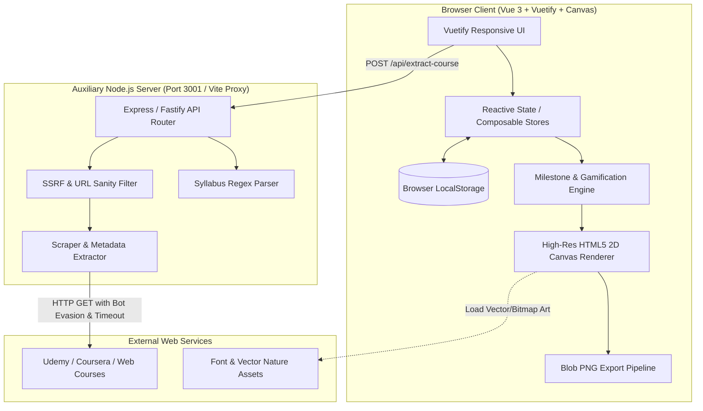
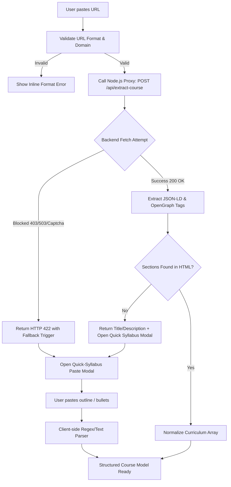
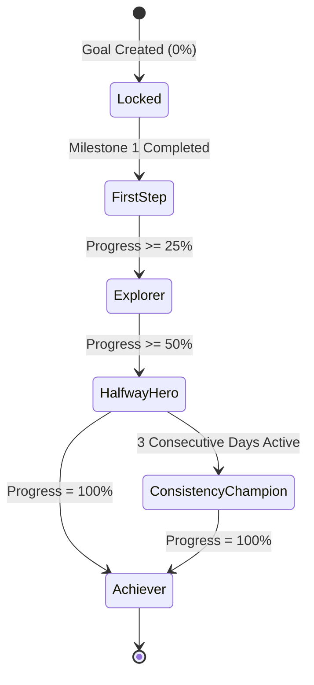

# Horizon — Technical Architecture Specification

**Document Version:** 1.0.0  
**Status:** Under Architectural Review  
**Author:** Senior Software Architect  
**Technology Foundation:** Vue.js 3.5.x | Vuetify 3.x/4.x | Vite 5.x/6.x/8.x | Node.js 24.x | Vanilla JavaScript (ESNext + JSDoc)

---

## 1. System Topology & Architecture Overview

Horizon is structured as a **Decoupled Client-Centric Application** supported by a **Lightweight Auxiliary Metadata Proxy Service**.



### 1.1 Architectural Rationale: Client-Centric Design
1. **Zero Operating Cost & Maximum Privacy:** By hosting user data (goals, milestones, progress) strictly in `LocalStorage`, the user maintains complete data sovereignty. No personal progress data leaves the browser.
2. **Offline Capable:** Once loaded, milestone toggling, badge calculations, and wallpaper exports function 100% offline without an active internet connection.
3. **Sub-second Rendering:** Rendering on a local Canvas element avoids server roundtrips, image upload latencies, or server-side GPU/headless browser costs (e.g., Puppeteer).

---

## 2. Technology Stack Evaluation & Technical Decisions

### 2.1 Frontend Framework: Vue.js 3.5.x
- **Decision:** Confirmed Vue.js 3.5.x using the **Composition API** (`<script setup>`).
- **Justification:** Vue 3.5 introduced major reactivity memory optimizations (up to 56% memory reduction for reactive dependencies) and streamlined SSR/hydration helpers. For Horizon, reactive computed state allows instant, zero-lag synchronization between milestone checkboxes, progress bars, and the live wallpaper preview canvas.

### 2.2 UI Library: Vuetify
- **Decision:** Vuetify 3.7+ (Vue 3 production branch).
- **Justification:** Horizon requires a clean, accessible, mobile-first design. Vuetify supplies production-ready date pickers, sliders, modal dialogs, responsive cards, and Material Design Icons without writing custom CSS resets.

### 2.3 Language Choice: JavaScript (ESNext + JSDoc) vs. TypeScript
- **Decision:** **Strict JavaScript with JSDoc Type Annotations** (No TypeScript compiler step).
- **Architectural Justification:**
  1. *No Build Transpilation Friction:* Avoids TypeScript configuration discrepancies between Vite, Vuetify plugin types, and Node.js 24 native ES modules.
  2. *Development Velocity:* For a focused application like Horizon, writing clean JSDoc (`@typedef`, `@type`, `@param`, `@returns`) provides full IntelliSense, autocomplete, and static type linting in VS Code / IDEs without `tsc` build bottlenecks.
  3. *Adherence to Project Constraints:* Conforms directly to the user's requirement: *"Do not introduce TypeScript unless you can provide a strong technical justification."* Plain JavaScript is completely adequate and simplifies the build pipeline.

### 2.4 Node.js Backend: Why It Is Strictly Necessary
- **Question:** Can Horizon be 100% frontend without a Node.js backend?
- **Answer:** **No, a lightweight Node.js backend proxy is technically mandatory** for URL course imports.
  - **Browser CORS Barrier:** The W3C Cross-Origin Resource Sharing policy strictly forbids browser clients (`fetch()` or `XMLHttpRequest`) from making requests to external domains (e.g., `udemy.com`, `coursera.org`) unless the remote server explicitly serves `Access-Control-Allow-Origin: *`. Udemy does not allow arbitrary cross-origin client calls.
  - **Cloudflare / Bot Defense:** Platforms like Udemy place aggressive Cloudflare anti-bot guards on their web endpoints. Direct requests from automated tools are greeted with HTTP 403 Forbidden or JavaScript challenge gates.
  - **Server-Side Extraction Solution:** A lightweight Node.js Express/Fastify service running alongside Vite acts as an authorized gateway. It can fetch OpenGraph data, parse static HTML JSON-LD scripts, sanitize the output, and pass structured JSON back to the Vue client.

---

## 3. Course URL Retrieval & Scraping Architecture

### 3.1 The Reality of Scraping Modern E-Learning Platforms (Udemy, Coursera)
Scraping external platforms like Udemy introduces major technical hurdles:
1. **Robots.txt & Terms of Service:** Udemy's `robots.txt` disallows automated crawling of private and search endpoints. Horizon will only inspect public course landing pages.
2. **Cloudflare WAF / Fingerprinting:** Public requests from cloud IPs (AWS/DigitalOcean/GCP) or headless browsers are frequently blocked by Cloudflare turnstiles.
3. **Client-Side SPA Hydration:** Many course details are rendered dynamically via React or injected into JSON blobs (`<script id="__NEXT_DATA__">` or `window.__UDEMY_DATA__`).

### 3.2 Multi-Tier Ingestion Strategy



### 3.3 Backend Metadata Extractor Implementation Spec
- **Endpoint:** `POST /api/course-info/extract`
- **Request Body:** `{ "url": "https://www.udemy.com/course/..." }`
- **Parser Pipeline:**
  1. **SSRF Guard:** Ensure hostname is an external FQDN, not `localhost`, `127.0.0.1`, or private RFC 1918 subnets (`10.0.0.0/8`, `192.168.0.0/16`).
  2. **Fetch Execution:** Request URL with standard browser headers (`User-Agent: Mozilla/5.0...`, `Accept-Language: en-US`). Timeout: $4000\text{ ms}$.
  3. **Cheerio / Regex Extraction:**
     - `og:title` $\rightarrow$ Course Title.
     - `og:description` $\rightarrow$ Course Summary.
     - `<script type="application/ld+json">` $\rightarrow$ Extract `Course` schema (provider, instructor, aggregateRating, timeRequired).
     - Udemy-specific section headers: Scan for standard curriculum accordion selectors (`div[class*="curriculum"]`, `div[class*="section--title"]`).
4. **Fallback Syllabus Parser (Client-Side & Server-Side):**
   When scraping fails or is blocked, the user pastes raw curriculum text. The parser utilizes heuristics:
   - Matches Roman numerals, numbering (`1.`, `Module 1:`, `Section 1:`, `Day 1:`), or bullet points (`-`, `*`).
   - Cleans timestamps (e.g., stripping `(12:45)` or `2 hours`).
   - Outputs normalized array: `[{ id: 1, title: "Foundations of LLMs", lecturesCount: 8 }]`.

---

## 4. Milestone Planning Algorithm

### 4.1 Pacing Mathematics
Given:
- Total course sections: $N \in \mathbb{N}_{\ge 1}$
- Available duration: $D \text{ days}$ ($D \in \mathbb{N}_{\ge 1}$)
- Start date: $T_0$, Target deadline: $T_{\text{end}} = T_0 + D$

Horizon implements a **Balanced Milestone Allocation Engine**:

```javascript
/**
 * Distributes N sections across D days into discrete milestones.
 * @param {Array<string>} sections - List of course section titles
 * @param {number} totalDays - Target deadline duration in days
 * @param {string} pacingStrategy - 'UNIFORM' | 'FRONT_LOADED' | 'REVIEW_BUFFER'
 * @returns {Array<Milestone>} Generated milestones
 */
export function generateMilestonePlan(sections, totalDays, pacingStrategy = 'REVIEW_BUFFER') {
  const N = sections.length;
  if (N === 0 || totalDays <= 0) return [];

  // If duration is long (> 10 days), allocate 10-15% of total days as review/buffer
  const bufferDays = (totalDays > 10 && pacingStrategy === 'REVIEW_BUFFER') 
    ? Math.max(1, Math.floor(totalDays * 0.12)) 
    : 0;
  const activeDays = totalDays - bufferDays;

  const milestones = [];
  
  if (N <= activeDays) {
    // Fewer or equal sections than days: each section gets 1 or more dedicated days
    const daysPerSection = activeDays / N;
    sections.forEach((sec, idx) => {
      const scheduledDay = Math.round((idx + 1) * daysPerSection);
      milestones.push({
        id: `ms-${idx + 1}`,
        order: idx + 1,
        title: sec,
        targetDay: Math.min(scheduledDay, activeDays),
        isQuiz: /quiz|assessment|exam|test|capstone/i.test(sec),
        completed: false,
        completedAt: null
      });
    });
  } else {
    // More sections than active days: bundle sections proportionally
    const sectionsPerDay = N / activeDays;
    let currentSectionIdx = 0;

    for (let day = 1; day <= activeDays; day++) {
      const nextSectionBoundary = Math.round(day * sectionsPerDay);
      const bundled = sections.slice(currentSectionIdx, nextSectionBoundary);
      
      if (bundled.length > 0) {
        milestones.push({
          id: `ms-${milestones.length + 1}`,
          order: milestones.length + 1,
          title: bundled.length === 1 ? bundled[0] : `${bundled[0]} (+${bundled.length - 1} more)`,
          subSections: bundled,
          targetDay: day,
          isQuiz: bundled.some(s => /quiz|assessment|exam|test/i.test(s)),
          completed: false,
          completedAt: null
        });
        currentSectionIdx = nextSectionBoundary;
      }
    }
  }

  // Insert final capstone / review milestone if buffer days exist
  if (bufferDays > 0) {
    milestones.push({
      id: `ms-${milestones.length + 1}`,
      order: milestones.length + 1,
      title: "Final Review & Knowledge Synthesis",
      subSections: ["Comprehensive practice", "Course capstone"],
      targetDay: totalDays,
      isQuiz: true,
      completed: false,
      completedAt: null
    });
  }

  return milestones;
}
```

### 4.2 Real-Time Progress Calculation
Progress is defined strictly as:
$$\text{Progress \%} = \left( \frac{\sum_{i=1}^{M} \mathbb{I}(\text{milestone}_i.\text{completed} = \text{true})}{M} \right) \times 100$$
where $M$ is the total count of generated milestones.
No arbitrary or simulated progress is permitted.

---

## 5. Gamification & Badge Calculation State Machine

Badges are managed as a pure reactive calculation from the list of milestones and system date:



### 5.1 Badge Evaluation Logic
```javascript
export function evaluateBadges(milestones, consecutiveActiveDays = 1) {
  const total = milestones.length;
  if (total === 0) return [];
  
  const completed = milestones.filter(m => m.completed).length;
  const pct = (completed / total) * 100;

  return [
    {
      id: 'FIRST_STEP',
      name: 'First Step',
      icon: 'sprout',
      unlocked: completed >= 1,
      unlockedAt: milestones.find(m => m.completed)?.completedAt || null,
      description: 'Conquered your first milestone'
    },
    {
      id: 'EXPLORER',
      name: 'Learning Explorer',
      icon: 'compass',
      unlocked: pct >= 25,
      description: 'Reached 25% of your target journey'
    },
    {
      id: 'HALFWAY_HERO',
      name: 'Halfway Hero',
      icon: 'mountain-flag',
      unlocked: pct >= 50,
      description: 'Crossed the 50% summit halfway mark'
    },
    {
      id: 'CONSISTENCY',
      name: 'Consistency Champion',
      icon: 'water-stream',
      unlocked: consecutiveActiveDays >= 3,
      description: 'Maintained steady progress 3 days in a row'
    },
    {
      id: 'ACHIEVER',
      name: 'Goal Achiever',
      icon: 'summit-sun',
      unlocked: pct === 100,
      description: '100% completion of all milestones'
    }
  ];
}
```

---

## 6. Wallpaper Rendering & Export Engine: Architectural Comparison

A critical architectural decision is how to transform the dynamic visual layout into an uncompressed, razor-sharp static PNG.

### 6.1 Comparison Matrix

| Evaluation Criteria | Approach 1: HTML/CSS to Image (`html2canvas` / `dom-to-image`) | Approach 2: Native HTML5 2D Canvas API (Recommended) | Approach 3: Dynamic SVG-to-Canvas |
| :--- | :--- | :--- | :--- |
| **Export Dimensions Fidelity** | Poor. Highly sensitive to browser window size, CSS subpixel rounding, and zoom levels. | **Flawless.** Native rendering context directly bounded to $1080 \times 1920$ or $1920 \times 1080$. | Good, but complex font rasterization when converting SVG string to blob. |
| **Typography & Font Rendering** | Blurry text on high-DPI; prone to font substitution if web fonts are still loading. | **Razor-sharp.** Can explicitly invoke `document.fonts.ready` before rasterizing text baselines. | Crisp, but text layout wrapping requires tedious `<foreignObject>` hacks. |
| **CORS / Canvas Tainting** | High risk. Remote images or SVGs taint the canvas, blocking `.toDataURL()` or `.toBlob()`. | **Zero risk.** Embedded vector patterns and local assets are preloaded as clean Image bitmaps. | Medium risk if external resources are embedded in SVG. |
| **Mobile Safe-Zone Precision** | Hard to enforce across arbitrary viewport heights without complex CSS `@media` rules. | **Exact Mathematical Offsets.** Safe-zones ($y = 280\text{ px}$, $y = 1720\text{ px}$) are hardcoded constants. | Mathematical offsets supported. |
| **Rendering Performance** | Slow ($800\text{ ms} - 2500\text{ ms}$). Re-parses the entire DOM tree. | **Blazing Fast ($30\text{ ms} - 120\text{ ms}$).** Direct 2D GPU-accelerated drawing calls. | Fast ($100\text{ ms} - 300\text{ ms}$). |
| **Bundle Size Overhead** | Heavy (adds $150\text{ KB} - 300\text{ KB}$ runtime library). | **Zero extra dependencies.** Uses native browser standard `HTMLCanvasElement`. | Negligible. |

### 6.2 Architectural Recommendation: Native HTML5 2D Canvas Engine
**We firmly recommend Approach 2: Native HTML5 2D Canvas.**
- **Why?** Horizon is fundamentally a graphic generation utility. Lock screens are intensely scrutinized by users. Any blurred typography, misaligned badge icon, or clipped text will immediately degrade user trust.
- The 2D Canvas API gives complete mathematical control over text wrapping, radial gradients, safe-zone bounding boxes, progress arcs, and badge icon placement.

### 6.3 Canvas Coordinate Layout & Safe-Zone Geometry

#### A. Mobile Wallpaper Geometry (1080 × 1920 px)
```
+---------------------------------------------------+ y = 0
| [TOP SYSTEM RESERVED ZONE: 0 - 280 px]            |
| Status Bar (Battery, WiFi), Lock Screen Big Clock |
| Dynamic Island / Camera Notch                     |
+---------------------------------------------------+ y = 280
| [SAFE INFORMATION ZONE: 280 - 1680 px]            |
|                                                   |
| y = 320: Category Pill & Goal Title (Bold 54px)   |
| y = 460: Target Countdown Card ("12 DAYS LEFT")   |
|                                                   |
| y = 720: Nature Graphic & Circular Progress Bar   |
|          "65% COMPLETED"                          |
|                                                   |
| y = 1100: Active Milestone Card                   |
|           "Current: 05. Retrieval-Augmented Gen"  |
| y = 1260: Upcoming Milestone Card                 |
|           "Next: 06. Transitioning to Training"   |
|                                                   |
| y = 1420: Unlocked Badges Row (5 Circular Icons)  |
| y = 1560: Dynamic Motivational Quote              |
+---------------------------------------------------+ y = 1680
| [BOTTOM SYSTEM RESERVED ZONE: 1680 - 1920 px]     |
| Camera / Flashlight Quick Buttons                 |
| iOS Home Bar / Android Navigation Pill            |
+---------------------------------------------------+ y = 1920
```

#### B. Desktop Wallpaper Geometry (1920 × 1080 px)
- Asymmetrical 2-Column Split:
  - **Left 60% ($x: 0 \dots 1152\text{ px}$):** Panoramic Nature Scenic art, subtle horizon gradient, and motivational quote.
  - **Right 40% ($x: 1152 \dots 1920\text{ px}$):** Frosted glass data HUD card containing Countdown, Milestone Progress arc, Active & Upcoming Milestones, and Achievement Badges.
  - Top & Bottom margins reserved ($80\text{ px}$) to prevent interference with OS taskbars and menu bars.

### 6.4 The 8 Nature Templates Implementation Design
Templates are built with a combination of procedural 2D Canvas gradient mesh backgrounds and crisp vector nature silhouette overlays:
1. `alpine-peak`: Emerald `#0B3B24` to Slate `#1E293B`, mountain polygon silhouettes, mist particles.
2. `pine-mist`: Dark Sage `#1C3026` to Silver Moss `#4A6B5D`, vertical pine tree trunks with alpha blur.
3. `highland-solitude`: Steel Blue `#1E2D42` to Dusk Navy `#0F172A`, contour topographic elevation lines.
4. `deep-pacific`: Abyssal Blue `#051923` to Cyan `#006494`, underwater caustics and light rays.
5. `azure-shore`: Golden Sand `#DDA15E` meeting Aquamarine Ocean `#0077B6`, foam boundary gradient.
6. `golden-horizon`: Peach Glow `#F77F00` to Midnight Violet `#1D1E2C`, sun disc with atmospheric haze.
7. `dusk-silhouette`: Deep Magenta `#7209B7` to Twilight Blue `#03071E`, ridge silhouette with star pinpoints.
8. `minimalist-stone`: Soft Charcoal `#212529` to Warm Stone `#495057`, zen river stone smooth curves.

---

## 7. Security, Privacy & Validation

1. **SSRF Protection on Proxy:**
   - External URL fetch requests are strictly checked against DNS resolution.
   - Prohibit IP ranges: `127.0.0.0/8`, `10.0.0.0/8`, `172.16.0.0/12`, `192.168.0.0/16`, `169.254.0.0/16`, and `::1`.
   - Protocol restriction: Only `http:` and `https:`.
2. **Payload Size Limits:**
   - Proxy enforces a maximum response size limit ($2\text{ MB}$) to prevent decompression bombs or memory overflow.
   - Max timeout: $5000\text{ ms}$.
3. **Canvas Data Sanitization:**
   - Text inputs (Goal Title, Milestone descriptions) are stripped of control characters and strictly truncated before rendering to prevent canvas text buffer overflow or off-screen bleeding.
4. **Zero Auth / Zero Cookie Transmission:**
   - Scraper proxy runs statelessly without cookies, credentials, or session tokens.
